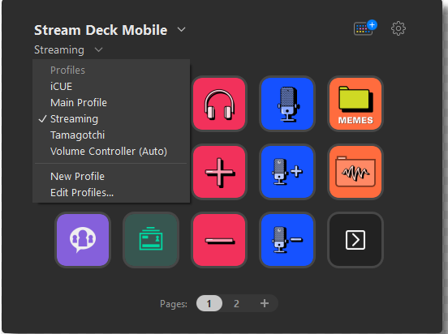
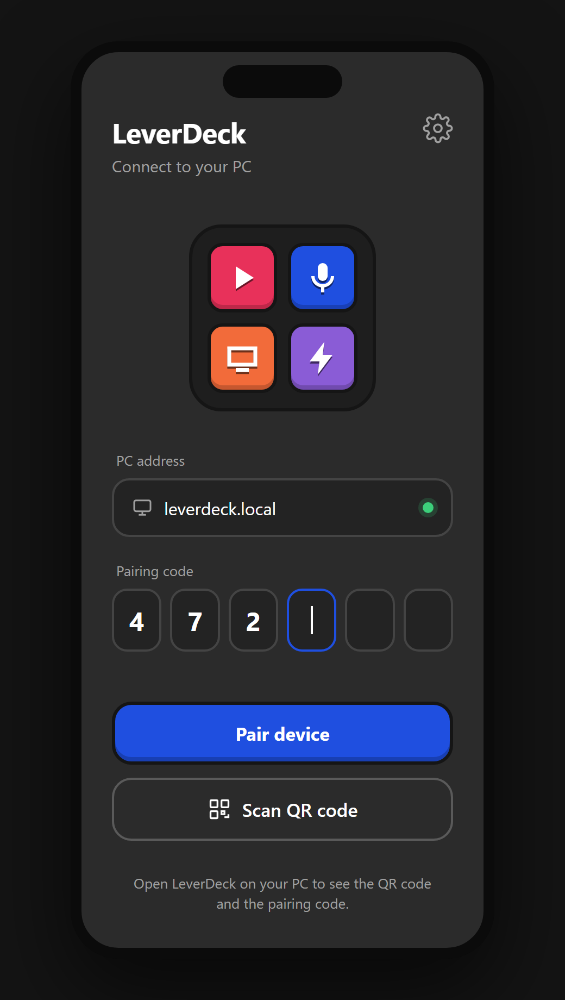

# Visual Reference

This is the look and feel the LeverDeck mobile app (the PWA on the phone or tablet) must follow. Every new screen,
mock or generated image — the deck, pairing, settings, or a login/connect screen — should read as part of the same
family as the reference below.

The reference is Elgato's Stream Deck Mobile. We borrow its **aesthetic**, not its brand: never copy its logo, name,
icons or exact artwork.

## Aesthetic in one sentence

A calm, dark charcoal surface where the only loud things are big, rounded, saturated keys with simple bold icons.

## Surface and layout

- Background: flat dark charcoal (around `#2B2B2B`), no gradients, no textures, no glassmorphism.
- Header at top-left: device/app name in bold white, a small chevron for a dropdown, and the active profile name
  underneath in muted grey with its own chevron. Utility icons (settings gear, device badge) sit top-right as thin
  outlined glyphs.
- Content is a regular grid of square keys with even gutters (roughly 15–20% of the key size), centered on screen.
- Page navigation is a small pill at the bottom ("Pages: 1 2 +"), with the active page as a light filled circle.
- Generous empty space; nothing decorative outside the keys.

## Keys

- Square with large corner radius (about 20% of the key size) and a thin dark border/inset ring that separates the key
  from the background.
- Each key is a single solid saturated color: hot red/pink (`#E8315A`), electric blue (`#1F4FE0`), orange (`#F26B3A`),
  lavender purple (`#8A5CD6`), deep teal green (`#2F5B4E`), near-black (`#1E1E1E`).
- Color groups meaning: keys that belong together share a color (for example all audio-volume keys red, all mic keys
  blue).
- Icons are large (about 60% of the key), bold and flat, white or one contrasting accent, with a subtle black outline
  or drop shadow that gives a slightly sticker-like, illustrated feel.
- Optional short label inside the key in heavy uppercase sans-serif (like "MEMES").
- An empty or navigation key uses the near-black fill with a thin light outline icon.

## Menus and overlays

- Dropdowns are dark grey panels (slightly lighter than the background, around `#3A3A3A`) with square-ish corners and a
  soft shadow.
- A small muted section title ("Profiles"), white menu items, a check mark on the selected item, and a thin divider
  before secondary actions ("New Profile", "Edit Profiles…").

## Typography

- Clean geometric/grotesque sans-serif (Segoe UI, Inter or similar).
- White for primary text, mid grey (`#A0A0A0`) for secondary text. Bold for titles, regular for menu items.

## Rules for new screens

- Dark theme first. A light theme, if added, must keep the same saturated keys on a light neutral surface.
- Large touch targets (keys and primary buttons at least 48 px), WCAG AA contrast for text and icons.
- Saturated color is reserved for actionable things (keys, the primary button, the active state). Chrome stays grey.
- Use the LeverDeck name, never "Stream Deck" or Elgato branding.

## Mocks

- Login / connect screen: [mocks/login.html](mocks/login.html), rendered as
  [assets/mock-login.png](assets/mock-login.png).

## Example: prompt for a login / connect screen

Use this as the base prompt when generating a mock image of the pairing or login screen:

> Mobile app screen, portrait phone, dark flat charcoal background (#2B2B2B). Top-left: bold white title "LeverDeck"
> with a small grey subtitle "Connect to your PC". Center: a large rounded-square app icon made of a 2x2 grid of
> saturated keys (red, blue, orange, purple) with thin dark borders. Below it, a dark grey rounded input field labelled
> "PC address" with placeholder "leverdeck.local", and a pairing code field with six separated digit boxes. A wide
> primary button with large rounded corners in electric blue (#1F4FE0) reading "Pair device", and a secondary
> outlined button "Scan QR code" with a thin white QR icon. Small muted grey helper text at the bottom: "Open
> LeverDeck on your PC to see the QR code". Bold flat icons with subtle dark outline, sticker-like style, generous
> spacing, no gradients, no glassmorphism, Segoe UI / Inter typography, Stream Deck Mobile–inspired aesthetic without
> any Elgato branding.
